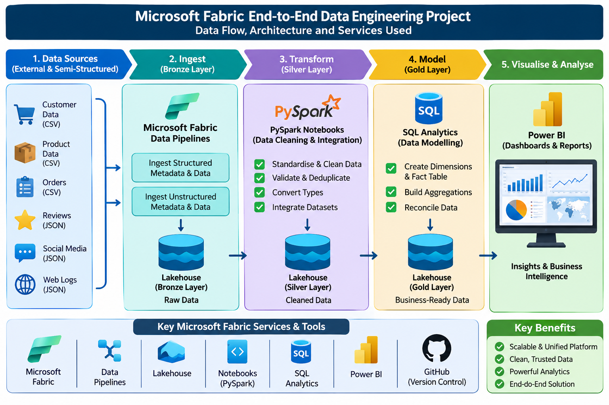

# Microsoft Fabric End-to-End Data Engineering

An end-to-end e-commerce data engineering project built with Microsoft Fabric, PySpark, and Delta Lake. It demonstrates metadata-driven ingestion, data cleaning and validation, and analytical modelling using the Medallion Architecture.

## Project Overview

The solution ingests structured CSV and semi-structured JSON data into a Bronze Lakehouse, transforms it into validated Silver Delta tables, and builds Gold dimensions, facts, and aggregates for analytics.

## Project Architecture and Data Flow

The diagram below shows how data moves through the Microsoft Fabric project, from source files to business intelligence reports.



## Architecture and Implementation

### Bronze: ingestion

Two Fabric pipelines ingest source files:

| Pipeline | Input | Per-file activities |
|---|---|---|
| `pl_ingest_structured` | Structured CSV files | `Delete_existing_files` → `copy_orders_to_bronze` |
| `pl_ingest_unstructured` | Semi-structured JSON files | `Delete_existing_files` → `Copy_orders_to_bronze_layer` |

Both pipelines use metadata-driven iteration. The metadata JSON is available in the Bronze Lakehouse before its Lookup activity runs. In the exported pipeline definitions, a metadata Copy activity stages the metadata from an HTTP source into the Lakehouse; the Lookup then reads it. A ForEach iterates over the metadata entries, deletes an existing destination file, and copies in the new file. The delete-before-copy order is explicit in the activity dependencies.

The metadata files are stored under `E-comm_MetaData_Source` as `Structured_MetaData_Files` and `Unstructured_MetaData_Files`. Pipeline connections and source references may need to be configured for another Fabric workspace.

### Silver: cleaning and validation

`notebooks/nb_silver_transform.ipynb` reads the Bronze CSV and JSON data with PySpark, standardizes fields, applies type conversions, filters invalid values, and deduplicates records. It writes the resulting Silver tables in Delta format.

For orders, the notebook checks customer and product references against the Silver customer and product data. Valid orders are retained in `orders`; records that fail this reference validation are written to `orders_rejected` for review. The notebook also cleans product reviews, social media records, and web logs, including timestamp conversion for event data.

### Gold: analytical model

`notebooks/nb_gold_transform.ipynb` reads the Silver tables and creates Delta tables in the `dbo` schema:

- **Dimensions:** `dim_customer`, `dim_product`, `dim_date`
- **Fact:** `fact_orders`
- **Aggregates:** `agg_product_reviews`, `agg_social_sentiment`, `agg_web_engagement`

The date dimension is generated from the order date range. The notebook reconciles total sales in the Silver orders data against the Gold fact table.

## Recorded Validation Results

The following row counts and reconciliation value are from the saved outputs in the project notebooks:

| Dataset | Input rows | Output rows | Removed/rejected |
|---|---:|---:|---:|
| Customers | 100 | 100 | 0 |
| Products | 50 | 50 | 0 |
| Orders | 3,000 | 2,939 | 61 |
| Product reviews | 3,000 | 2,938 | 62 |
| Social media | 3,000 | 3,000 | 0 |
| Web logs | 3,000 | 3,000 | 0 |

All 61 orders rejected by the customer/product reference checks were retained in `orders_rejected`.

The saved Gold notebook output records 100 rows in `dim_customer`, 50 in `dim_product`, 1,096 in `dim_date`, 2,939 in `fact_orders`, 50 in `agg_product_reviews`, 2,712 in `agg_social_sentiment`, and 3,000 in `agg_web_engagement`.

**Sales reconciliation:** the notebook output reports `769420.82` in both Silver orders and Gold `fact_orders` (R769,420.82), and the equality assertion passed.

These are recorded notebook results, not a guarantee that a fresh run against different or changed source data will produce the same counts or total.

## Technologies

- Microsoft Fabric Data Pipelines and Lakehouse
- Python and PySpark
- Delta Lake
- SQL
- Medallion Architecture
- Power BI for downstream reporting

## Repository Structure

```text
Microsoft-Fabric-End-to-End-Data-Engineering/
├── README.md
├── architecture/
│   └── medallion-architecture.png
├── pipelines/
│   ├── pl_ingest_structured/
│   └── pl_ingest_unstructured/
├── notebooks/
│   ├── nb_silver_transform.ipynb
│   └── nb_gold_transform.ipynb
├── SQL/
├── documentation/
│   └── project-documentation.pdf
└── .gitignore
```
